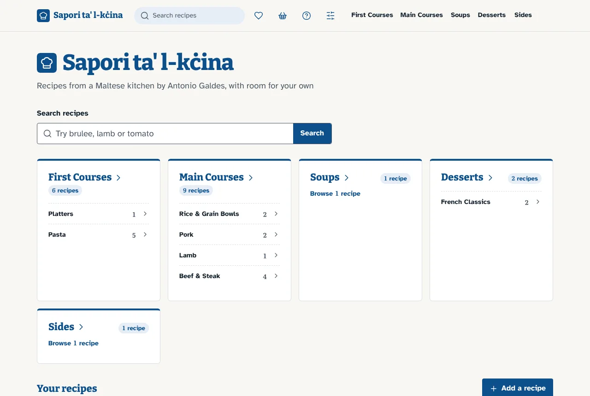
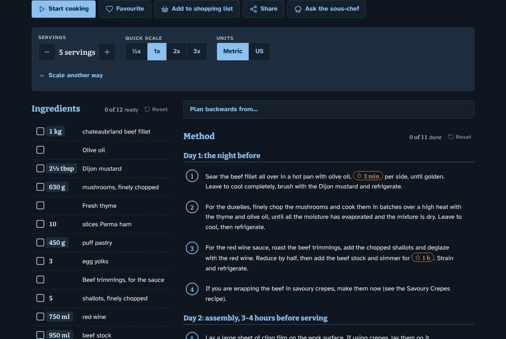
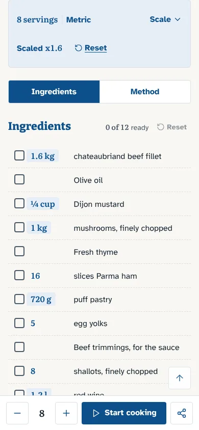
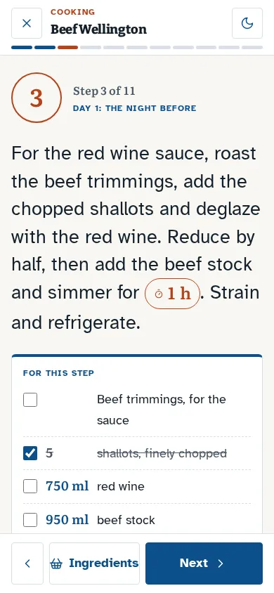
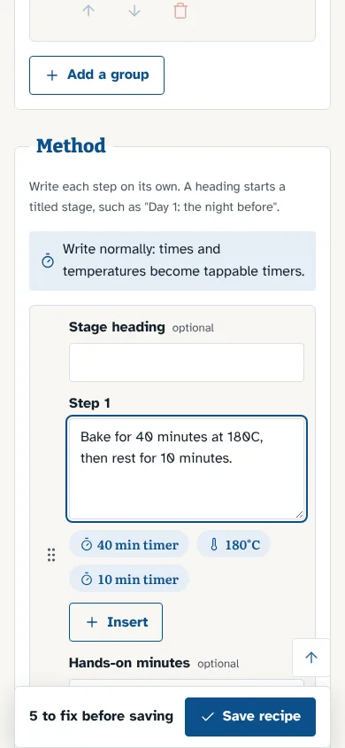
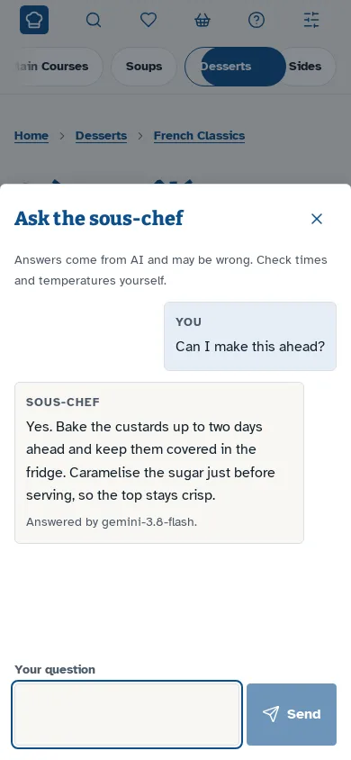
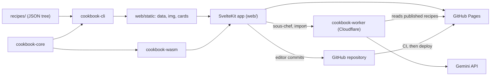

# Sapori ta' l-kċina

A static recipe site with scaling, unit conversion, cook mode and a shopping list, built from a tree of JSON recipes around a Rust core.

[](https://github.com/Expo39/My_Cookbook/actions/workflows/ci.yml)

Live site: <https://expo39.github.io/My_Cookbook/>

## Contents

- [Overview](#overview)
- [Screenshots](#screenshots)
- [Features](#features)
- [Tech stack](#tech-stack)
- [Architecture](#architecture)
- [Quick start](#quick-start)
- [Usage](#usage)
- [Project layout](#project-layout)
- [Testing](#testing)
- [Deployment](#deployment)
- [Documentation](#documentation)
- [Contributing](#contributing)
- [Licence](#licence)

## Overview

Every recipe is one JSON file under `recipes/`, and the folder tree gives the site its sections. A Rust core (`cookbook-core`) holds the schema, the scaling engine, the unit tables, the ingredient-line parser, search and the recipe checklist. The same core runs at build time, through the `cookbook-cli` command line tool, and in the browser, compiled to WebAssembly, so the build and the page can never disagree about an amount.

The web app is a SvelteKit site, pre-rendered with `adapter-static` and published on GitHub Pages. Anyone can add recipes of their own, which stay in their browser; the cookbook's own recipes are edited from the site by the token holder, whose editor commits to GitHub, and CI checks and deploys the change. An optional Cloudflare Worker adds an AI sous-chef and a recipe importer, and an optional Axum server can host the whole cookbook without GitHub Pages.

## Screenshots

The "Bright Mediterranean" design: sea blue and terracotta on limestone white, with a dark theme to match.

| Home | A recipe, in the dark theme |
|---|---|
|  |  |

| Scaled on a phone | Cook mode | Adding your own recipe | The sous-chef |
|---|---|---|---|
|  |  |  |  |

A one-minute walkthrough, with captions, is on the site's [How to use](https://expo39.github.io/My_Cookbook/how-to-use) page.

## Features

### Reading and cooking

- Section pages and recipe pages pre-rendered for every folder and recipe, with `Recipe` JSON-LD and Open Graph tags.
- Search that ignores accents, and an ingredients mode that ranks recipes by how many of their ingredients the cook already has. The search page shows how to search with examples to tap, and offers the ingredients mode when a comma is typed.
- Small "i" circles explain the less obvious controls: a bubble on hover with a mouse, a note underneath on a phone.
- Cook mode: one step at a time in large type, with the ingredients that step uses listed under it to tick off (found from the step's words, so recipes need no extra markup), the full list beside it on a wide screen or one tap away on a phone, the next step previewed, a "Ready to serve" screen with the chef's tips at the end, keyboard and swipe navigation, and a screen wake lock where the browser supports one.
- Timers started from the method, kept as end times so they survive a reload, and able to run side by side.
- A "serve at" planner that works back from a serving time when the steps carry timings.
- Ticks on ingredients and steps, private notes, favourites and recently viewed recipes, all kept on the device. Ticks follow the ingredient or step, so they survive an update to the recipe, and cook mode shares them with the recipe page. Until a first step is ticked, a hint and a gently breathing first circle show that a step's number can be tapped.
- A recipe updated while it is open offers its new version in place, keeping the servings, ticks, timers and list.
- A how-to page covering every feature, with a recorded walkthrough.
- Recipe variants (for example vanilla extract or pods), each replacing ingredients, steps and tips by key.

### Scaling and units

- Scaling by servings, by multiplier, by pan size (area ratio) or by the amount of one ingredient.
- Per-ingredient scaling modes: linear, whole pieces, seasoning ("start low"), fixed and to taste.
- Metric and US units, with density-based conversion between weight and volume, and oven temperatures in °C, °F and gas mark.
- View state in the URL (`?serves=6&u=us`), so a link, a QR code and the print view show the same recipe.

### Sharing

- **Share** opens straight onto a recipe card drawn in the browser for the current scale, units and variant, with every ingredient (long ones wrap; long lists run in two columns) and a QR code for the recipe.
- On a phone, **Send the card** hands the image and the link to the system share sheet (WhatsApp, Messenger, Instagram and so on), optionally with the whole recipe as text; most computers get **Copy the card** instead. **Save image**, **Send the link**, **Copy as text** and **Print** (an A5 index card) sit beside it. A recipe kept on the device has no link yet.
- Share cards (Open Graph, portrait and story) rendered at build time with the same layout.
- A shopping list that merges ingredients across recipes and can be shared as text. Your own items are typed as you would write them ("2 kg potatoes"), and any amount can change its number and unit.

### Your own recipes

- Anyone can add recipes, with no account and no token. They are kept in the browser (IndexedDB), appear on the home page and in their section marked "Yours", and have every feature of a published recipe.
- The editor is friendly in this mode: write the ingredient list as on paper and watch it read back as you type, write the method in plain words ("bake for 25 minutes at 200C" becomes a timer and a converted temperature), and find the rarer fields folded away.
- Export (text, CSV or JSON) and clear-all in Settings, a first-time note and a weekly reminder that they live only in this browser, and search and favourites include them.
- **Share with everyone** hands a recipe to the cookbook with the GitHub token, after which it is the cookbook's.

### Editing

- An in-site editor with a live preview and the recipe checklist running in WebAssembly as the recipe is typed.
- One commit per save, carrying the recipe, its photo and any new sections, followed by the CI and deploy status.
- Moving a recipe to another section or address, conflict protection against overwriting a newer version, and a delete check for recipes that still link to it.
- The `add-recipe` skill for Claude Code, which turns pasted text, a link or a photo into a checked recipe file.

### AI

- A sous-chef chat on each recipe page, your own recipes included, with the answer streamed as it is written and labelled with the model that wrote it. As it opens it says whether the cook is offline, the service is unreachable or the AI is in high demand. A busy, retired or out-of-quota model hands over to a lighter fallback (Google's newest Flash-Lite), and the cook is told; a silent model is given up after 25 seconds. Cloudflare Turnstile checks that a person is asking, and per-visitor and site-wide limits keep bots from draining the quota.
- Import from text in the editor, which fills the form for review.
- Both go through a Cloudflare Worker (or the self-hosted server), so the Gemini key never reaches the browser. Without an AI endpoint, both are hidden.

### Security

- A Content Security Policy on every page: only the site's own scripts run, and the page talks only to the AI worker, GitHub and Turnstile.
- The editing token is encrypted in the browser with the owner's password, kept per tab, and can only write recipe files.
- The worker serves only the cookbook's own pages, and the importer needs a signed proof.

### Offline

- A service worker caches the app shell and visited pages, so a recipe opened once can be cooked from without a connection.
- A web app manifest and icons, so the site can be installed.

## Tech stack

| Area | Technology |
|---|---|
| Core logic | Rust (edition 2024), no IO, compiled for native and `wasm32-unknown-unknown` |
| Browser bindings | `wasm-bindgen`, size-checked by `scripts/build-wasm.sh` |
| Web app | SvelteKit 2, Svelte 5, Vite, `adapter-static` |
| Build tooling | `cookbook-cli` (clap, `image`, `resvg` for the share cards) |
| AI proxy | Cloudflare Worker in Rust (`workers-rs`), Gemini |
| Self-hosting | Axum, Tokio, argon2, Docker Compose, Caddy |
| Tests | cargo-nextest, Vitest with happy-dom, Playwright |
| Toolchain | Docker and `make`; nothing else is installed on the host |
| Hosting | GitHub Pages through GitHub Actions |

## Architecture



The core is the single source of truth for the schema and the checklist. The CLI turns the recipe tree into the JSON, images and cards that the site reads; the SvelteKit app pre-renders every page from that data and loads the WebAssembly build of the core for scaling, units and search on the device. See [docs/ARCHITECTURE.md](docs/ARCHITECTURE.md) for the build pipeline, the editor flow, the data seams and the security model.

## Quick start

Prerequisites: Docker (with Docker Compose) and GNU `make`. Every toolchain runs in the `dev` container defined in `docker-compose.yml`.

```sh
git clone https://github.com/Expo39/My_Cookbook.git
cd My_Cookbook
make image       # build the dev image, once
make dev         # dev server on http://localhost:5173
```

Other common targets:

```sh
make test-fast   # Rust, Vitest and the recipe checklist
make test        # everything, including Playwright against the built site
make check       # the recipe checklist alone
make build       # WebAssembly and the static site into web/build
make preview     # the production build, served as Pages serves it, at http://localhost:5173/My_Cookbook/
make lint        # rustfmt, clippy, svelte-check, prettier and eslint
make hooks       # install the pre-push hook (once per clone)
```

The full list is in [docs/DEVELOPMENT.md](docs/DEVELOPMENT.md).

## Usage

### Browsing and cooking

The home page lists the top-level sections and recently added recipes, with search in the header. A recipe page has a servings bar (stepper, multiplier, Metric/US switch and the extra scaling controls), the ingredients and the method. Tapping an amount cycles it through its units; tapping a timer in the method starts it. **Start cooking** opens cook mode, which steps through the method with the arrow keys, the on-screen buttons or a swipe, and starts the current step's timer with Space.

### Shopping list

**Add to shopping list** on a recipe adds its ingredients at the current scale. The list (`/shopping-list`) merges the same food across recipes, lets items be ticked off, and **Share list** shares it as text. Adding a recipe again updates its entry instead of doubling it. **Add an item** takes anything else in one box, written as on paper; tapping any amount opens a small card to change its number and unit.

### Sharing

**Share** opens on a preview of the recipe card for the current view. **Send the card** (or **Copy the card** on a computer) sends it with the link, **Send the link** shares the address with the servings, units and variant in it, **Copy as text** copies the whole recipe, and **Print** prints an A5 index card.

### Adding a recipe

There are four routes, and all of them end in the same recipe checklist (`cookbook-cli check`), so a recipe cannot go live unless every check passes.

- **On the device.** **Add a recipe** on the home page opens the editor without any token; the recipe is saved in the browser. **Share with everyone** in **Settings > Your recipes** later commits it to the cookbook with the GitHub token.
- **The in-site editor.** Open **Settings**, then **For the cookbook's owner**, and unlock editing with the password. **New recipe** opens a blank form; every recipe page has an **Edit** button. Saving commits to GitHub and shows the build status. The first set-up and the rest of the editor are described in [docs/ADMIN.md](docs/ADMIN.md).
- **The `add-recipe` skill.** In Claude Code, paste a recipe, a link or a photo. The skill writes the JSON file under `recipes/`, runs the checklist and proposes a commit.
- **By hand.** Write the JSON file following [docs/RECIPE_FORMAT.md](docs/RECIPE_FORMAT.md), then run `make check`.

## Project layout

```text
.
|-- recipes/               the content: one JSON file per recipe, _section.json per folder
|-- crates/
|   |-- cookbook-core/     schema, scaling, units, parser, search, checklist (no IO)
|   |-- cookbook-tree/     reads the recipes/ folder from disc
|   |-- cookbook-cli/      check, build, cards, verify-site, schema, migrate-legacy
|   |-- cookbook-wasm/     wasm-bindgen bindings used by web/
|   |-- cookbook-ai/       Gemini prompts and request types
|   |-- cookbook-worker/   Cloudflare Worker for the AI routes
|   `-- cookbook-server/   Axum server for self-hosting
|-- web/                   the SvelteKit app, its unit tests and Playwright suite
|-- assets/                fonts and the share card layout, shared by the CLI and the web app
|-- design-system/sapori/  the visual rules and page overrides
|-- docker/                the dev and server images, and a Caddy example
|-- docs/                  the documentation
|-- scripts/               the WebAssembly build script
|-- .githooks/             the pre-push hook
|-- .github/workflows/     CI and deploy
|-- cookbook.config.json   site settings read at build time
|-- docker-compose.yml     the dev and selfhost services
`-- Makefile               every command, run in Docker
```

## Testing

| Tier | Command | What runs |
|---|---|---|
| Fast | `make test-fast` | `cargo nextest` over the workspace, Vitest, and the recipe checklist |
| Full | `make test` | the fast tier, the site build, `verify-site`, and the Playwright suite against the built site |
| CI | `.github/workflows/ci.yml` | the same checks as parallel jobs on every pull request into `main` and every push to `main` |

Budgets are enforced: a Rust test over 10 s, a Vitest test over 2 s, a Playwright run over 90 s or a gzipped WebAssembly bundle over 200 KB fails. The e2e suite runs against the built site with all network mocked. Details are in [docs/DEVELOPMENT.md](docs/DEVELOPMENT.md).

## Deployment

- **GitHub Pages** is the main target. CI runs on pull requests into `main` and on pushes to `main`; the deploy workflow publishes the exact site artifact that CI built and tested, and only after CI succeeds on a push. Changes that touch only documentation skip the build and the deploy.
- **The AI Worker** is deployed separately with `wrangler` and needs a `GEMINI_API_KEY` secret.
- **Self-hosting** runs `cookbook-server` with Docker Compose (`make selfhost`), optionally behind Caddy for HTTPS.

See [docs/DEPLOYMENT.md](docs/DEPLOYMENT.md).

## Documentation

| Document | Contents |
|---|---|
| [docs/README.md](docs/README.md) | the documentation index |
| [docs/ARCHITECTURE.md](docs/ARCHITECTURE.md) | components, build pipeline, data seams, security model |
| [docs/RECIPE_FORMAT.md](docs/RECIPE_FORMAT.md) | the recipe schema, the folder tree and the step tokens |
| [docs/ADMIN.md](docs/ADMIN.md) | the in-site editor: set-up, editing, saving, AI import |
| [docs/CONFIGURATION.md](docs/CONFIGURATION.md) | `cookbook.config.json` and the build-time variables |
| [docs/DEPLOYMENT.md](docs/DEPLOYMENT.md) | GitHub Pages, the AI Worker and self-hosting |
| [docs/DEVELOPMENT.md](docs/DEVELOPMENT.md) | `make` targets, conventions, tests and troubleshooting |
| [design-system/sapori/MASTER.md](design-system/sapori/MASTER.md) | the visual rules |
| [CONTRIBUTING.md](CONTRIBUTING.md) | how to propose a change |

## Contributing

Contributions go through a pull request into `main`, and the **CI passed** check must be green before a merge. See [CONTRIBUTING.md](CONTRIBUTING.md).

## Licence

The source code is licensed under the [MIT licence](LICENSE). The recipes and photos in `recipes/` are licensed under [Creative Commons Attribution-NonCommercial 4.0](recipes/LICENSE.md) (CC BY-NC 4.0): they may be shared and adapted with credit for non-commercial purposes.
