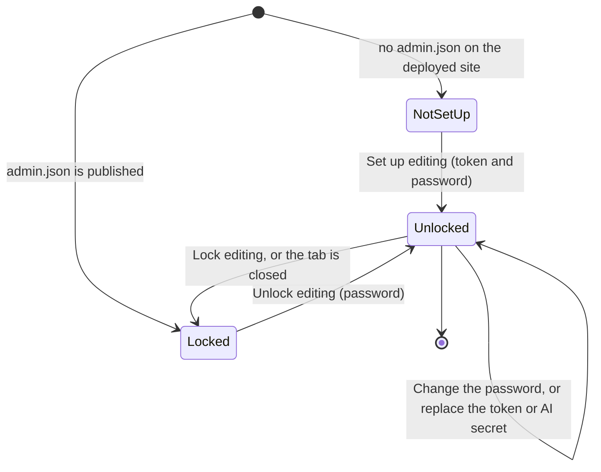

# Editing recipes from the site

Anyone can add recipes of their own from the site. Those recipes are kept in the visitor's browser and belong to them: they can change or delete them, and nobody else sees them. The cookbook's published recipes belong to its owner and can only be changed by whoever holds the GitHub token.

With the token unlocked, recipes can be added, changed, moved and deleted in the cookbook itself, without a checkout or a terminal. On GitHub Pages the editor commits straight to the repository, so every change goes through the same checklist and CI as any other and reaches the site when the deploy finishes. On a self-hosted server the editor writes through the server's API instead.

The other ways to add a recipe are the `add-recipe` skill for Claude Code and editing the JSON files by hand (see [RECIPE_FORMAT.md](RECIPE_FORMAT.md)). All of them end in the same recipe checklist, so a recipe cannot go live unless every check passes.

## Contents

- [Recipes on this device](#recipes-on-this-device)
- [Sharing a recipe with everyone](#sharing-a-recipe-with-everyone)
- [Adding a photo](#adding-a-photo)
- [Editing states](#editing-states)
- [Setting up editing](#setting-up-editing)
- [Unlocking on another device](#unlocking-on-another-device)
- [Changing the password or the token](#changing-the-password-or-the-token)
- [The editor](#the-editor)
- [Saving and the build status](#saving-and-the-build-status)
- [Moving a recipe](#moving-a-recipe)
- [Conflict protection](#conflict-protection)
- [Deleting a recipe](#deleting-a-recipe)
- [Importing a recipe with AI](#importing-a-recipe-with-ai)
- [Self-hosted mode](#self-hosted-mode)

## Recipes on this device

**Add a recipe** (on the home page, on a section page, and in **Settings > Your recipes**) opens the editor at `/edit` without any token. A recipe saved there goes to the browser's IndexedDB, not to GitHub, and appears on the home page under "Your recipes" and in its section, marked "Yours". It opens at `/mine?id=<id>`, which shows it with every feature of a published recipe (scaling, units, timers, cook mode, the shopping list and the sous-chef) and a note that it is kept in this browser only.

The editor is simpler in this mode, so that someone who has never seen a recipe file can fill it in:

- A short introduction says that a title, the ingredients and the method are all a recipe needs.
- The first time, a note at the top says the recipe is kept only in this browser, with **Got it**.
- The ingredients are written as on paper, one per line, in the same way as for the cookbook's own recipes (see [Form sections](#form-sections)). The key is not offered here.
- The method is written in plain words. "Bake for 25 minutes at 200C" is saved as `Bake for {timer:25} at {temp:200}`, so the cook gets a timer and a converted temperature, and the editor lists what it found under each step. Hours and minutes, ranges ("20-25 minutes"), seconds, Fahrenheit and fan temperatures ("180°C (160°C fan)") are recognised. When the recipe is opened again the tokens are shown as the same words. The insert tools are not offered, since plain words cover them.
- The local name, what a serving is called, the difficulty, tags, tips and related recipes are under **More details (optional)**.
- The web address follows the title and is not shown, and the photo field and the AI import are not offered; a photo is added on the recipe's own page instead (see [Adding a photo](#adding-a-photo)). A new section or subsection can still be added; it stays with the recipe on the device, and the recipe shows under "Your recipes".
- The checks pane is called **To do**.

**Settings > Your recipes** counts the recipes on the device, says plainly that they live only in this browser, and has **Export your recipes** (text, a CSV spreadsheet or JSON) and **Clear all personal recipes**, which asks first and names how many will be deleted. There is no import: the browser is asked to keep the site's storage, but clearing the site's data deletes the recipes, so the cook is told when they first add one (a note in the editor with **Got it**) and reminded about once a week on the home page, with **Export** and a close button that rests it for a week.

## Sharing a recipe with everyone

Each recipe in **Settings > Your recipes** has **Share with everyone**. Sharing needs the GitHub token: while editing is locked, the button points at the **For the cookbook's owner** panel below it, where the token is set up or unlocked as described in the rest of this guide.

Once unlocked, **Share with everyone** asks for confirmation, then commits the recipe to `recipes/<id>.json` on the configured branch (`content(recipes): add <title>`), exactly as the token holder's editor would. From then on the recipe is the cookbook's: the copy on the device is marked as shared and locks, and the cookbook's copy appears after the next deploy. When the deployed index carries the recipe, the shared copy is removed from the device the next time the site loads. A commit that touches only `recipes/` takes CI's fast path (see [DEPLOYMENT.md](DEPLOYMENT.md#the-fast-path)), so it is live in a few minutes.

## Editing states

Editing is controlled from **Settings** (the sliders icon), under **For the cookbook's owner**. What that panel shows depends on whether editing has been set up for the site and whether it is unlocked in the current tab.

| State | What the owner's panel shows |
|---|---|
| Not set up | The set-up form: GitHub token, password, repeated password and an optional AI import secret |
| Locked | A password field and **Unlock editing** |
| Unlocked | **New recipe**, **Lock editing**, **Change the password** and **Replace the token or AI secret** |

The token is kept for the current tab only, so closing the tab, or **Lock editing**, returns to the locked state.

## Setting up editing

Editing needs a GitHub token that can commit to the repository. The token is encrypted in the browser with a password and committed to the repository as `web/static/admin.json`, so that any device can unlock editing with the password alone. This is done once per site.

### 1. Create a fine-grained token

1. On GitHub, open **Settings > Developer settings > Personal access tokens > Fine-grained tokens** and choose **Generate new token**.
2. Give it a name, for example "Cookbook editor".
3. **Resource owner:** the account or organisation that owns the repository.
4. **Expiration:** the longest period that is acceptable. When the token expires, replace it (see [Changing the password or the token](#changing-the-password-or-the-token)).
5. **Repository access:** **Only select repositories**, then the cookbook repository and nothing else.
6. **Permissions > Repository permissions > Contents:** **Read and write**. Leave every other permission at **No access**. **Metadata: Read-only** is added automatically.
7. Generate the token and copy it. GitHub shows it only once.

### 2. Set up editing on the site

1. Open **Settings > For the cookbook's owner**. The set-up form appears while no editing key has been published.
2. Paste the token into **GitHub token**.
3. Choose a password of at least 12 characters and repeat it. A passphrase of several unrelated words is stronger than a short, complex password.
4. If the AI importer is deployed, paste its secret into **AI import secret** (see [Importing a recipe with AI](#importing-a-recipe-with-ai)). It can be added later.
5. Press **Set up editing**.

The site checks that the token can push to the repository, encrypts the token (and the import secret) in the browser, and commits `web/static/admin.json` to the configured branch. Editing is unlocked straight away on that device. Other devices see the set-up form until the commit has been deployed.

If the repository is not `Expo39/My_Cookbook`, or the site is deployed from a branch other than `main`, set `admin.repo` and `admin.branch` in `cookbook.config.json` before setting up (see [CONFIGURATION.md](CONFIGURATION.md)).

### What is stored, and the trade-off

`web/static/admin.json` is public, like everything else in the repository. It holds the token and the optional import secret, encrypted with AES-256-GCM under a key derived from the password with PBKDF2-SHA256 at 600,000 iterations. A new random salt and nonce are generated each time the file is written.

Anyone can download that file and try passwords against it offline, with no limit on attempts. The password is the only defence, which is why it must be at least 12 characters long. Someone who guesses it obtains a token that can change files in this one repository and nothing else; every change stays in git history and can be reverted.

Two things limit the exposure:

- The token is scoped to one repository and to Contents only. It cannot read other repositories, change settings or see secrets.
- Once unlocked, the token is held in memory and in `sessionStorage` for that tab. It is never written to `localStorage`.
- The editor refuses to save any file outside `recipes/` (a recipe, a section file or a photo), so even a tampered recipe cannot make it write elsewhere in the repository.

If the password may have been guessed, revoke the token on GitHub immediately, create a new one and set up again. Deleting `web/static/admin.json` removes the old copy from the site, though not from git history.

## Unlocking on another device

Open **Settings > For the cookbook's owner**, enter the password and press **Unlock editing**. The browser downloads `admin.json` from the site, derives the key and decrypts the token locally. A wrong password shows a short message and nothing else happens. The editor page at `/edit` offers the unlock form itself when a published recipe is opened while editing is locked.

## Changing the password or the token

Both options are in **Settings > For the cookbook's owner** while editing is unlocked, and each commits a new `admin.json`. The change reaches other devices with the next deploy.

- **Change the password** asks for the current password and the new one (twice), decrypts the stored secrets with the current password and re-encrypts them under the new one. The token itself does not change.
- **Replace the token or AI secret** is for a token that has expired or been revoked, or for a new import secret. It asks for the password; a field left blank keeps the value already stored.

## The editor

With editing unlocked, **New recipe** in Settings opens a blank form that saves to GitHub, and every recipe page has an **Edit** button. Without the token, the same page edits recipes on the device instead (see [Recipes on this device](#recipes-on-this-device)); a published recipe opened there says it is part of the cookbook and offers to add a recipe of one's own. The editor is one static page at `/edit`. It is kept out of search engines and out of the site's search index.

When an existing recipe is opened, the editor loads it from the repository (or the server) as it is stored now, not from the published site, so an edit always starts from the latest saved version.

The form sits beside the checks ("Before you save") and a live preview. On a phone these become three tabs: **Edit**, **To do** and **Preview**.

### Form sections

- **Basics.** Title, local name, summary, servings and what one serving is called, prep, cook and rest times in minutes, difficulty and tags.
- **Where it lives.** A **Section**, then an optional **Subsection** inside it. **New section** and **New subsection** under each add one, each with an "i" explaining it; new sections are created in the same commit as the recipe. **Web address** (optional, with an "i") shows the whole link, the section part muted and the part made from the title in bold. **Change** opens a box where the section part sits fixed in front and only the last part can be typed; **Follow the title again** undoes a change and **Done** folds it away. It opens by itself when it has a problem or the recipe is being moved. Changing the section or address of an existing recipe moves it (see [Moving a recipe](#moving-a-recipe)).
- **Photo.** A JPEG, PNG or WebP image. It is scaled to at most 1600 px wide and re-encoded as a JPEG in the browser, which also drops location data. A description (alt text) is required. A photo narrower than 1200 px gets a warning.
- **Ingredients.** **Write the list** is the main way: one ingredient per line, as on paper ("400 g plain flour", "2-3 cloves garlic, crushed", "salt to taste", "1 tbsp honey (optional)"), read as it is typed with the same parser the site uses. Bullets, list numbers and extra spaces are tidied away, and a line ending in a colon ("For the filling:") starts a new part with its own heading. **How it will read** shows each line as the recipe will, and marks a line whose amount was not recognised; **Ways to write a line** stays in view as a reminder. A line that still reads the same keeps everything the list cannot show (its key, scaling, other units). **Line by line** is for fine-tuning: each row has the amount (a range such as "2-3" is typed in the same box), unit, ingredient and note, with **More options** for "Can it be left out?", what happens to the amount when the servings change, and, for the cookbook's own recipes, the key. A part has a name, a fold button and an optional total; two parts with the same name are pointed out, with **Move these into part N**.
- **Method.** One field per step. **Add a heading** opens an optional heading, above the step and the ones after it, for a method in stages ("Day 1: the night before"). **Hands-on time** and **Waiting time** take minutes, each with an "i". For the cookbook's own recipes, **Add to this step** puts a timer or a temperature into the step as a token (`{timer:25}`, `{temp:180}`); [RECIPE_FORMAT.md](RECIPE_FORMAT.md) lists the tokens. A step never repeats an amount: it names the ingredient ("add the butter") or says how much in words ("half the olive oil", "the rest of the stock"), and the checklist stops a save with `E-STEP-AMOUNT` when a step has an amount such as "1 tbsp" in it, explaining how to write it instead.
- **Tips.** The recipe's tips, one per row.
- **Related recipes.** Other recipes that pair with this one, chosen by searching.
- **Variants.** Shown and kept exactly as they are, but not editable in the form. Change them in the recipe's JSON file.
- **Delete.** Only on an existing recipe (see [Deleting a recipe](#deleting-a-recipe)).

### Before you save

The **Before you save** panel runs the same checks as `cookbook-cli check`, live in WebAssembly, after every change, and lists what is left in plain words ("Give the recipe a name.", "Add the ingredients."), numbered, with no check codes. Each point takes the cook to its field. Errors keep the recipe from saving; suggestions are folded under **Suggestions, if you like**. The save bar reads "3 things left to fill in" or "Ready to save".

### The preview

The preview renders the recipe with the same components as the public recipe page, so scaling, tokens and tips appear as readers will see them.

### Drafts

The form is saved on the device about half a second after every change, separately for each recipe and for a new recipe. When the editor is opened again with a draft present, it offers **Restore the draft** or **Discard it**. Leaving the page with unsaved changes asks for confirmation first. A draft is removed once the recipe is saved.

## Saving and the build status

**Save recipe** checks once more for conflicts, then makes one commit to the configured branch containing the recipe, its photo and any new sections. The commit message is `content(recipes): add <title>` or `content(recipes): update <title>`. If the photo was replaced, the old photo file is removed in the same commit.

The editor then follows the CI and Deploy runs for that commit, checking every 5 seconds for up to 15 minutes:

| Status | Meaning |
|---|---|
| Building | CI and the deploy are running. CI runs the full suite before the site is deployed, so this takes a few minutes. |
| Live | The deploy has succeeded. **View the recipe** opens it. |
| A later save replaced this build | A newer push cancelled this run; the change goes live with the later build. |
| The build failed | A link opens the failed run on GitHub. The commit is already in git, so the fix is another change. |
| The build status is not available just now | The runs could not be read. The commit has still been made. |

If another commit reached the branch while the save was being made, the editor rebuilds its commit on the newest one and tries again.

## Moving a recipe

A recipe's section and web address can be changed in **Where it lives**. Saving a moved recipe makes one commit that:

- moves the recipe file to its new path,
- moves its photo with it, and
- updates every recipe that lists it under related recipes, so their links follow the new address.

While a recipe is being moved, the editor shows its old and new addresses and the save button reads **Move and save**. On the self-hosted server the move is one request, followed by a save of any other edits; if those edits fail, the editor says the recipe has already moved and names its new address.

The recipe's id is its path, so moving it changes its URL.

## Conflict protection

The editor remembers the version of the recipe it opened. If the recipe has changed in the repository since then (for example, it was edited on another device or by a direct commit), the save is refused and nothing is written. The message asks for the page to be reloaded and the change made again. A new recipe whose address is already taken is refused in the same way.

The self-hosted server applies the same protection: a save of a recipe that changed after it was opened is refused, and no file is written.

## Deleting a recipe

**Delete this recipe**, in the **Delete** section of an existing recipe, first checks every other recipe for a link to it. The check reads the recipes from the repository branch, not only from the published site, so it also sees links added in commits that have not been deployed yet. If any recipe still lists it under related recipes, deleting is blocked and those recipes are named, each with a link to edit it.

Otherwise, typing the recipe's title confirms the deletion. The recipe file and its photo are removed in one commit (`content(recipes): remove <title>`), and git keeps the history.

## Adding a photo

Every recipe page has a place for its photo: on a phone across the top, above the title; on a wide screen in a column beside the title and the buttons, at 4:3, so the servings and ingredients stay in the first screenful. A recipe without one shows **Add a photo** there, a compact strip on every screen. It opens the phone's own picker, so the photo can come straight from the camera or from the gallery. The photo is scaled to at most 1600 px wide and re-encoded as a JPEG in the browser, which drops location data, then shown with a box for its description. The description is required, because the recipe checklist refuses a photo without one (`E-IMAGE-ALT`).

Where the photo goes follows the same rule as a recipe:

- **With editing unlocked, on one of the cookbook's recipes,** **Save photo** commits the photo and the recipe with its `image` set in one commit (`content(recipes): update <title>`), starting from the recipe as stored so nothing else in the file changes. The new photo shows at once, with a note that follows the build until it is live. A photo already there gets **Change**, which replaces it and removes the old file when its name differs. This is the way to add photos from a phone after the recipe has been added.
- **Otherwise** the photo is kept in this browser (IndexedDB), on any recipe without a cookbook photo and on the visitor's own recipes, marked "Only on this device", with **Change** and a bin to remove it. A cookbook photo, once there, is shown instead and cannot be changed without the token. Removing or clearing a recipe of one's own removes its photo, and renaming one moves it.
- **Share with everyone** sends a recipe's kept photo to the cookbook in the same commit as the recipe, then removes it from the device.

A page with a kept photo holds the photo's place from the first paint (the script in `app.html` reads which pages have one from `sapori:photos`), so a reload does not move the recipe down.

The full editor still has its **Photo** field for the cookbook's recipes, described under [Form sections](#form-sections).

## Importing a recipe with AI

When the site has an AI endpoint (`ai.endpoint` in `cookbook.config.json`, `PUBLIC_AI_ENDPOINT`, or the self-hosted server with `GEMINI_API_KEY`), a new recipe has **Import from text**. Pasting any recipe text fills the form for review. Nothing is saved by the import, and the checklist runs on the result like any other recipe.

The importer runs on Gemini's fast models, which follow explicit rules far better than they infer them, so it is guided and checked at every step:

- **The house rules.** Gemini is given `crates/cookbook-ai/prompts/recipe-style.md` word for word, with a worked example (`example-input.txt` and `example-output.json`). The `add-recipe` skill follows the same file, so a recipe reads the same however it was added. A test keeps the worked example passing the checklist.
- **A tight schema.** The answer must be JSON in the recipe's shape, every ingredient needs a name, and `food` can only be an id the density table knows.
- **One repair round.** When the checklist finds errors, the answer is not JSON, or two or more ingredients the text gives with an amount are missing, the problems go back to Gemini once to fix. The better of the two answers is kept.
- **Mending in code** (`crates/cookbook-ai/src/restore.rs`), comparing the answer with the pasted text: an amount the model dropped is put back from the text, read with the editor's own ingredient parser, and flagged with a warning to check (`W-IMPORT-AMOUNT`); a `{@key}` token stays only where the method repeats the amount; a size such as "23cm tin" taken for a temperature goes back to a number; times come only from the text's own labels ("Prep: 15 mins"); a tip must come from the text, and the "this amount is a guide" tip is written in code when a weight or volume range became its middle; `seasoning` and `fixed` scaling stay only on seasonings and per-item amounts; and a repeated line is dropped. Ingredients still missing after the repair are named in a warning (`W-IMPORT-MISSING`). Nothing is added that the text does not write.

Review the form before saving all the same: a wrong amount that the text itself gives cannot be caught. `make import-eval` tries the importer on real Gemini (see [DEVELOPMENT.md](DEVELOPMENT.md#make-targets)).

The importer is for the editor only. On GitHub Pages the Worker requires a proof signed with `ADMIN_IMPORT_SECRET`, so the same secret must be entered in the set-up form or under **Replace the token or AI secret**, where it is encrypted with the token. The Worker's rate limiter allows each visitor four requests a minute, and everyone together twenty. See [crates/cookbook-worker/README.md](../crates/cookbook-worker/README.md) for the Worker side.

## Self-hosted mode

When the site is built with `PUBLIC_BACKEND=server` (see [DEPLOYMENT.md](DEPLOYMENT.md#self-hosting)), there is no token and no `admin.json`, and editing is never in the "not set up" state. **Unlock editing** takes the server's admin password and sets a session cookie, and **Lock editing** signs out.

The editor then saves, uploads photos, creates sections and deletes through the server's API. The server runs the same checklist before it writes a file, refuses a save that would overwrite a newer version, and refuses a delete while other recipes link to the recipe. There is no build, so a change is live as soon as it is saved. With `GIT_COMMIT=true` the server also commits each change.

The password is changed through `ADMIN_PASSWORD_HASH` in the server's environment, not from the site.
