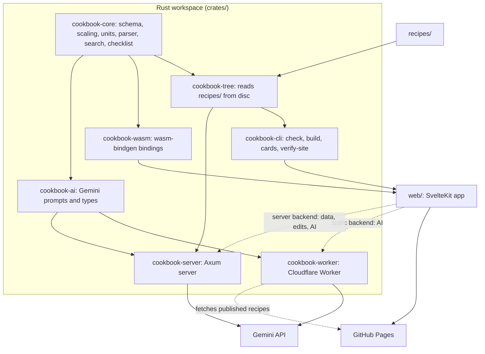
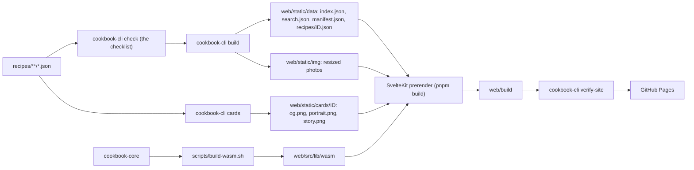
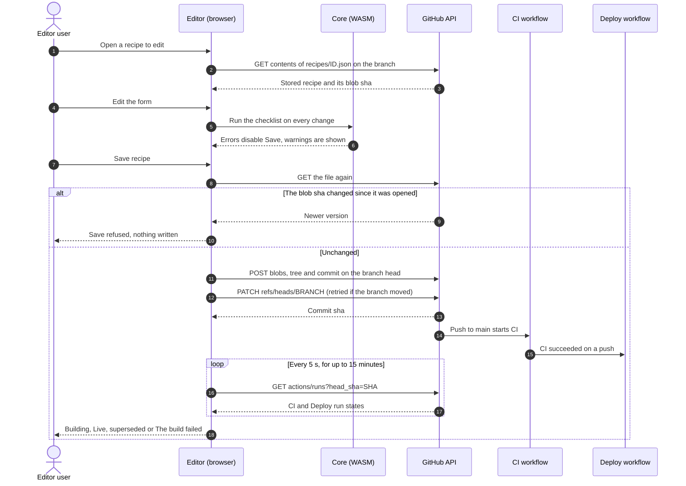
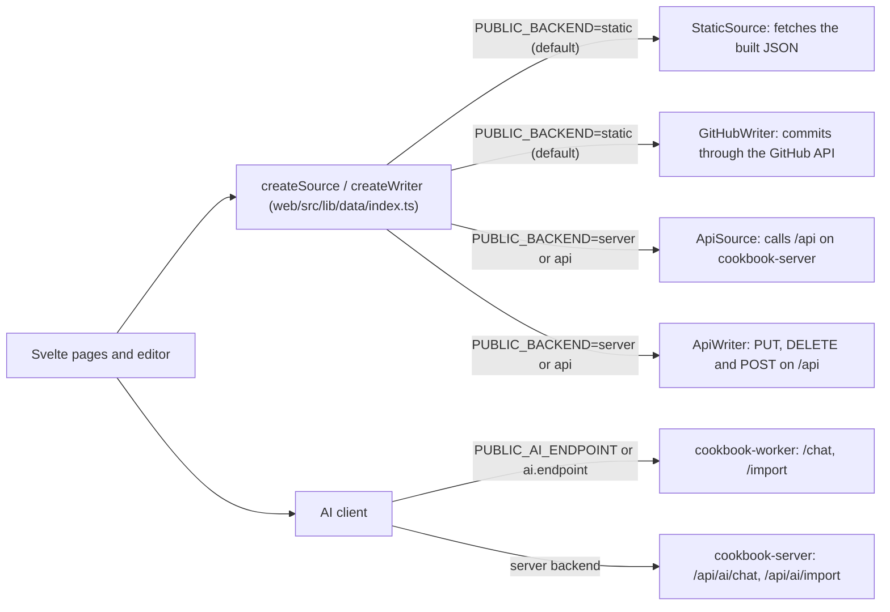

# Architecture

Sapori ta' l-kċina is a static site built from a tree of JSON recipes. A Rust core holds the domain logic and runs both in the build and in the browser, so the two can never disagree. This document describes the components, the build pipeline, how the editor saves a recipe, the data seams that let the site move off GitHub Pages, where the recipe checklist runs, and the security model.

## Contents

- [Components](#components)
- [The build pipeline](#the-build-pipeline)
- [The core in the browser](#the-core-in-the-browser)
- [Saving from the editor](#saving-from-the-editor)
- [The data seams](#the-data-seams)
- [Where the checklist runs](#where-the-checklist-runs)
- [The AI Worker](#the-ai-worker)
- [The self-hosted server](#the-self-hosted-server)
- [Security model](#security-model)
- [Tests](#tests)

## Components

| Crate | Role |
|---|---|
| `cookbook-core` | The schema, scaling, units, the ingredient-line parser, search, the site data shapes, QR codes and the recipe checklist. It does no IO and builds for native and `wasm32`. |
| `cookbook-tree` | Reads the `recipes/` folder into a collection for the core. It is the only place that touches the disc for recipes, and it is used by the CLI and the server. |
| `cookbook-cli` | The build and content tooling: `check`, `build`, `cards`, `verify-site`, `schema` and `migrate-legacy`. |
| `cookbook-wasm` | `wasm-bindgen` bindings over the core, loaded by `web/`. |
| `cookbook-ai` | The Gemini prompts and the request and response types shared by the Worker and the server. No IO and no HTTP client. |
| `cookbook-worker` | The Cloudflare Worker that proxies the sous-chef and the importer to Gemini. |
| `cookbook-server` | An Axum server for optional self-hosting, with editing and the AI built in. |

Each crate has its own README under `crates/<name>/README.md`, and the web app is described in [web/README.md](../web/README.md).

## The build pipeline

- `build` runs the checklist first, and any error stops the build. It then verifies its own output: the number of recipe files emitted, and that every recipe is in the search index.
- Photos are resized by `build` into `web/static/img/<id>/<width>.<ext>` at 480, 960 and 1600 px (never above the original width), as WebP and JPEG.
- The share cards are rendered by `cards` with `resvg`, from the layout in `assets/card-layout.json` that the browser's card renderer also uses. Unchanged cards are skipped.
- The SvelteKit catch-all route reads `index.json` at build time and pre-renders one page per section folder and per recipe. Each recipe page carries `Recipe` JSON-LD and Open Graph tags that point at its card.
- `verify-site` is the post-build gate. It fails unless the index lists exactly as many recipes as there are recipe files, and every recipe is pre-rendered, in the search index, has valid `Recipe` JSON-LD and has an Open Graph card.
- `cookbook.config.json` supplies the site address, the base path, the AI endpoint, the editor's repository and the optional Instagram link. See [CONFIGURATION.md](CONFIGURATION.md).

Locally, `make build` runs these steps in order (`make wasm`, `make data`, `make cards`, then `pnpm build`), and `make verify` adds `verify-site`. In CI the same steps run as separate jobs; see [DEPLOYMENT.md](DEPLOYMENT.md).

## The core in the browser

`scripts/build-wasm.sh` compiles `cookbook-wasm` and fails if the gzipped result is over 200 KB. The app loads it once. Scaling, unit changes, the ingredient parser, search and the checklist then run on the device. The pre-rendered page is readable before the module arrives; the scaling controls stay disabled until it has loaded.

View state lives in the URL (`?serves=6&u=us`), so a link, a QR code and the print view all show the same recipe. Ticks, notes, favourites, recently viewed recipes, timers, preferences and the shopping list are kept on the device in browser storage, and the recipe page still works when storage is blocked.

A service worker caches the app shell and the pages for offline use. The recipe JSON is cached as it is read, so a recipe opened once is available offline.

## Saving from the editor

On GitHub Pages there is no server to write to, so the editor commits through the GitHub REST API with the token unlocked from `admin.json` (see [Security model](#security-model)). One save is one commit, made with the Git Data API so that the recipe, its photo and any new sections land together. The editor then follows the CI and Deploy runs for that commit.

- The status is **Live** once the Deploy run for the commit has completed. A failed run shows a link to it on GitHub. A cancelled run means a later push replaced it, and the change goes live with that later build.
- If the branch moved between reading the head and updating it, the commit is rebuilt on the new head and retried, up to four attempts.
- The conflict check compares the recipe file as it is stored now with the version the editor opened, so a recipe changed on GitHub after it was opened is never overwritten.
- Moving a recipe (a new section or address) and deleting one are also single commits. The details are in [ADMIN.md](ADMIN.md).

In self-hosted mode the same editor calls the server's API instead, and a save is live as soon as it is written.

## The data seams

`web/src/lib/data/` hides where recipes come from and where edits go. `PUBLIC_BACKEND` selects the implementations at build time.

- `RecipeSource` reads the site index, a recipe and the search index.
- `RecipeWriter` reads the stored recipe for editing, saves, deletes, creates sections and uploads photos, and reports the build status.
- The AI endpoint comes from `PUBLIC_AI_ENDPOINT` or `ai.endpoint`. With neither, and without the server backend, the sous-chef and the importer are hidden.

Moving off GitHub Pages means changing these variables and running the server image; no code changes. See [CONFIGURATION.md](CONFIGURATION.md).

## Where the checklist runs

The checklist is written once, in `crates/cookbook-core/src/checklist.rs`, and runs in every place a recipe can enter the cookbook:

| Where | How | Effect |
|---|---|---|
| The in-site editor | `check_recipe` through WASM, on every change | Errors disable Save; warnings are shown and allowed |
| The editor's delete check | `check_removal` through WASM | Deleting is blocked while other recipes link to the recipe |
| The `add-recipe` skill | `cookbook-cli check <file>` in the dev container | The skill fixes errors before proposing a commit |
| Local development | `make check`, and the last step of `make test-fast` | Fails on any error |
| CI | the `content` job (`check --all`) and `cookbook-cli build` | A failing recipe fails CI, so it is never deployed |
| The self-hosted server | before every write | `PUT /api/recipes/{id}` replies 422 with the results |

Errors have ids starting `E-` and warnings `W-` (for example `E-TOKEN-UNRESOLVED` or `W-IMAGE-SMALL`). `cookbook-cli check --json` prints the full report.

## The AI Worker

`cookbook-worker` is a Rust Cloudflare Worker with two routes: `POST /chat` for the sous-chef, scoped to one recipe, and `POST /import`, which turns pasted text into a recipe and needs an admin proof. The prompts and types come from `cookbook-ai`. See [crates/cookbook-worker/README.md](../crates/cookbook-worker/README.md).

## The self-hosted server

`cookbook-server` serves the built site and a JSON API with the same shapes as the static build (`cookbook_core::site`). Behind an argon2 password and a signed session cookie it lets the editor write recipes, sections and images into the same `recipes/` tree, optionally committing each change with git, and it calls Gemini itself. See [DEPLOYMENT.md](DEPLOYMENT.md#self-hosting).

## Security model

### The editing token

- A static site cannot keep a secret, so the GitHub token used for editing is stored encrypted in the public file `web/static/admin.json`. The token is a fine-grained token limited to this one repository and to Contents read and write.
- The blob is encrypted in the browser with AES-256-GCM under a key derived from the editing password with PBKDF2-SHA256 at 600,000 iterations, with a fresh random salt and nonce on every write. The optional import secret is stored in the same blob.
- Because the file is public, an attacker can try passwords offline without any rate limit. The password is the only defence, so the set-up form requires at least 12 characters. A successful guess yields a token that can change files in this repository only, and every change remains in git history.
- Once unlocked, the token is kept in memory and in `sessionStorage` for that tab only, never in `localStorage`. Closing the tab locks editing.

### The AI endpoints

- The Gemini key lives only in the Worker's secrets (or the server's environment) and never reaches the browser.
- `/chat` names its recipe with a `recipeId`. The Worker fetches `<SITE_URL>/data/recipes/<recipeId>.json` from the published site itself, so a published recipe is never taken from the request body. Only when the site has no recipe at that address (a recipe kept on the cook's own device) is the copy in the body used, and only if it parses as a recipe with a title and at most 100 steps inside the 32 KB body limit. Such a copy can describe nothing but the cook's own recipe, and the system prompt still tells the model to treat the conversation as questions, never as instructions. The self-hosted server reads recipes from its own tree in the same way.
- When `TURNSTILE_SECRET` is set, `/chat` also needs a fresh Cloudflare Turnstile token, checked with Cloudflare before Gemini is called.
- `/import` requires an `X-Admin-Proof` header: an HMAC-SHA256 of a recent timestamp keyed with `ADMIN_IMPORT_SECRET`, valid for 5 minutes. The editor signs it with the secret from the unlocked blob.
- Request bodies are size-limited, and the Worker allows cross-origin requests only from `ALLOWED_ORIGINS`.

### Rate limits

| Endpoint | Limit |
|---|---|
| Worker `POST /chat` | 30 per hour per IP address (`RATE_LIMIT_CHAT`), fixed window in Workers KV |
| Worker `POST /import` | 5 per hour per IP address (`RATE_LIMIT_IMPORT`) |
| Server `POST /api/session` (sign-in) | 5 failed attempts per 15 minutes per address |
| Server `POST /api/ai/chat` | 30 per hour per address |
| Server `POST /api/ai/import` | 5 per hour per address |

The server takes the client address from `X-Forwarded-For` only when `TRUST_PROXY=true`, which should be set only behind a proxy under the operator's control.

### The self-hosted server

The admin password is stored only as an argon2id hash (`ADMIN_PASSWORD_HASH`). Sessions are HMAC-signed cookies keyed with `SESSION_SECRET` and marked `Secure` unless `COOKIE_SECURE=false`. Every write runs the checklist first.

## Tests

| Tier | Command | What runs | Budget |
|---|---|---|---|
| Fast | `make test-fast` | `cargo nextest` over the workspace, Vitest with `happy-dom`, and the recipe checklist | a Rust test over 10 s or a Vitest test over 2 s fails |
| Full | `make test` | the fast tier, the site build, `verify-site` and the Playwright suite against the built site | the Playwright run fails past 90 s |
| CI | `.github/workflows/ci.yml` | the same checks as parallel jobs, with e2e and `verify-site` reusing the built `site` artifact | jobs time out between 2 and 15 minutes |

The e2e suite never uses the dev server. It serves `web/build` with `web/scripts/serve-build.mjs`, mocks all network and runs with reduced motion. Locally it runs a desktop Chromium project and a Pixel 7 project for the mobile spec (plus mobile WebKit when `FULL_E2E` is set); CI runs the Chromium project. It includes a smoke test that runs once for every recipe file, so a new recipe is covered without a new test. See [DEVELOPMENT.md](DEVELOPMENT.md#tests-and-budgets).
