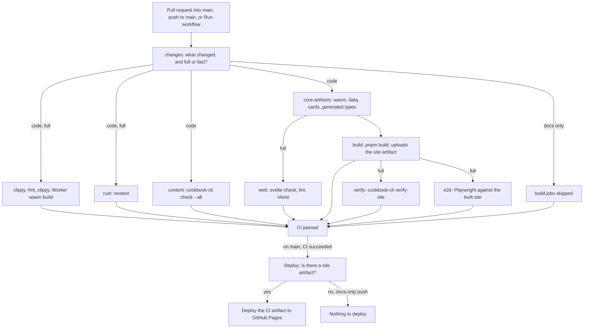
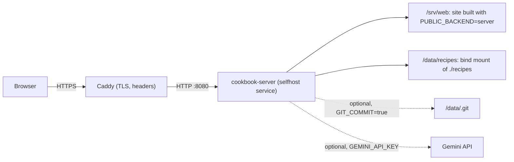

# Deployment

GitHub Pages is the main way to publish the cookbook. The AI features need a small Cloudflare Worker, deployed separately. Self-hosting is the alternative for running the cookbook without GitHub Pages: the same web app talks to an Axum server instead of reading static files.

## Contents

- [GitHub Pages](#github-pages)
- [The CI and deploy flow](#the-ci-and-deploy-flow)
- [Protecting main](#protecting-main)
- [The AI proxy (Cloudflare Worker)](#the-ai-proxy-cloudflare-worker)
- [Self-hosting](#self-hosting)

## GitHub Pages

The site is published from `main` only. Work happens on other branches and reaches `main` through pull requests.

1. In the repository's **Settings > Pages**, set **Source** to **GitHub Actions**.
2. Check `cookbook.config.json`: `site.url` and `site.basePath` must match the Pages address (`https://expo39.github.io` and `/My_Cookbook` for this repository). The CI build sets `BASE_PATH=/My_Cookbook` in `.github/workflows/ci.yml`; a fork under another name changes both. See [CONFIGURATION.md](CONFIGURATION.md).
3. Protect `main` as described in [Protecting main](#protecting-main).
4. Optionally, point the site at the AI Worker with `ai.endpoint` in `cookbook.config.json`.

There are no repository secrets to configure for Pages: the deploy uses the workflow's own token.

## The CI and deploy flow

CI (`.github/workflows/ci.yml`) runs on pull requests into `main`, on pushes to `main`, and on demand from the Actions tab. Deploy (`.github/workflows/deploy.yml`) runs only after CI completes successfully on a push to `main` or a manual run on `main`, and publishes the very `site` artifact that CI built, tested and verified; it never rebuilds the site.



- **CI passed** is the single required check. It fails if any job failed or was cancelled, and treats skipped jobs as passed, so a docs-only pull request can still be merged.
- A change that touches only `docs/` or Markdown files skips every build job. On a push to `main`, CI then succeeds without producing a `site` artifact, and the deploy workflow's first job finds no artifact and skips the deploy. The live site is unchanged.
- CI runs cancel an older run on the same branch when a newer one starts. The in-site editor reports a cancelled run as replaced by a later build, not as a failure.
- Every action in the workflows is pinned to a full commit, with its release in a comment, so a moved tag cannot change what runs. Dependabot (`.github/dependabot.yml`) opens a `ci` pull request once a month when a newer release appears.
- The Rust lints and the Rust tests are separate jobs that run side by side. Their caches are saved from `main` only (`save-if`) under shared keys, so branches and pull requests reuse `main`'s cache without filling the cache quota.

### The fast path

A full run takes about twelve minutes, most of it compiling and testing Rust. When only content has changed, that work proves nothing new, so CI has a fast mode. It still runs `changes`, `content` (the recipe checklist), `core-artifacts` and `build`, so a broken recipe still fails and the deployed site is still built by CI; it skips `clippy`, `rust`, `web`, `verify` and `e2e`. **CI passed** treats the skipped jobs as passed, so the deploy goes ahead.

CI takes the fast path when any of these holds:

- a push touches only `recipes/` (and, optionally, docs and Markdown), which covers every save from the in-site editor;
- the commit message contains `[fast ci]`;
- the pull request has the `fast-ci` label (adding or removing the label reruns CI in the matching mode);
- a manual run is started in fast mode.

To start a manual run: open the repository on GitHub, then **Actions > CI > Run workflow**, choose the branch (`main` to deploy), set **mode** to **fast** or **full**, and press **Run workflow**. A manual run on `main` deploys when it succeeds, in either mode. The mode is written in the run's summary.

Use the fast path for content only. A change to code that skips the tests can still go live, which is exactly what the full run exists to prevent; the pre-push hook still runs `make test` locally either way.

- Deploys never run concurrently and are not cancelled part-way.

## Protecting main

Nothing should reach `main` until everything passes.

- **On GitHub:** in **Settings > Rules > Rulesets**, create a branch ruleset:
  1. Set **Enforcement status** to **Active** and target the default branch (`main`).
  2. Turn on **Require a pull request before merging**.
  3. Turn on **Require status checks to pass** and add the **CI passed** check.
  4. Turn on **Block force pushes**.
  5. Under **Bypass list**, choose **Add bypass**, tick **Repository admin**, and set it to **Always allow**. This is what lets the in-site editor, and **Share with everyone** in Settings, commit straight to `main`.
  6. Press **Save changes**.

  If the ruleset already exists (for example as **Protect Main**), open **Settings > Rules > Rulesets > Protect Main**, scroll to **Bypass list**, add **Repository admin** as above and save.

  Contributors then reach `main` only through a pull request whose CI is green.
- **Locally:** run `make hooks` once per clone. It sets `core.hooksPath` to `.githooks`, whose `pre-push` hook runs `make test` before any push to `main` and refuses the push if anything fails. Pushes to other branches are not checked.

The bypass exists for the in-site editor. Its saves are direct commits to `main` made with the repository owner's token, and without the bypass the ruleset would reject every one. The bypass does not let untested work go live: CI still runs on every push to `main`, and Deploy runs only after CI succeeds, so a save that breaks the checklist or a test stays off the site until it is fixed. Direct pushes from a clone are still covered by the pre-push hook.

## The AI proxy (Cloudflare Worker)

The static site cannot hold the Gemini key, so the sous-chef and the importer go through `crates/cookbook-worker`, a Rust Worker configured in `crates/cookbook-worker/wrangler.toml`. Everything runs in the dev container, so nothing is installed on the host.

1. Create a Cloudflare API token from the **Edit Cloudflare Workers** template, export it as `CLOUDFLARE_API_TOKEN` (and `CLOUDFLARE_ACCOUNT_ID` if the token covers several accounts), and deploy. `wrangler login` is not used, because its browser callback cannot reach the container. The first deploy creates the `RATE_LIMIT` KV namespace and prints the Worker's URL.

   ```sh
   export CLOUDFLARE_API_TOKEN=...
   make worker-deploy
   ```

2. Add the secrets. `make worker-secrets` prompts for `GEMINI_API_KEY` (a Google AI Studio key), so it never reaches the shell history. It then generates `ADMIN_IMPORT_SECRET`, which keys the importer's admin proof, stores it in the Worker and prints it once to be kept for the site's editing settings.

   ```sh
   make worker-secrets
   ```

3. Check the variables in `wrangler.toml`:
   - `SITE_URL` is the published site including its base path (`https://expo39.github.io/My_Cookbook`). The Worker fetches each recipe for `/chat` from `<SITE_URL>/data/recipes/<id>.json`, so a published recipe is always discussed as published. Only when that address does not exist (a recipe kept on the cook's own device) is the copy sent with the question used, after it has been checked to be a recipe.
   - `ALLOWED_ORIGINS` lists the origins allowed to call it.
   - `GEMINI_MODEL` and `GEMINI_FALLBACK_MODEL` choose the models; the `[[ratelimits]]` blocks set how many questions a visitor, and everyone together, may ask a minute.
   - `GEMINI_THINKING_LEVEL` (default `low`) sets how long the model thinks before it answers; `minimal` is faster on the models that accept it, and `default` leaves the choice to the model. A model that refuses the level is asked again without one.
   - `GEMINI_FALLBACK_MODEL`, when set, takes over when the main model has been busy three times in a row, is out of its daily quota, has been retired by Google, or sends nothing for 25 seconds. It is set to `gemini-flash-lite-latest`, Google's alias for its newest Flash-Lite, so it never goes out of date; the main model stays pinned so its behaviour only changes on purpose. When Google retires the main model, the owner sees a notice in the sous-chef (with editing unlocked) naming the model to replace.
4. Set `ai.endpoint` in `cookbook.config.json` (or `PUBLIC_AI_ENDPOINT` at build time) to the Worker's URL, and enter the same `ADMIN_IMPORT_SECRET` in the site's editing settings (see [ADMIN.md](ADMIN.md#importing-a-recipe-with-ai)).

Answers are streamed to the browser as they are written. When Gemini is busy (a 429 for a per-minute limit, or a 500 or 503), the Worker waits a moment, with a little randomness so that cooks refused together do not return together, and asks again up to three times before it tries the fallback model, telling the cook it is switching. When every model stays busy, the cook is told the sous-chef is unavailable due to high demand, and `GET /status` reports "busy" for two minutes so the sous-chef can warn the next cook as it opens. Each refusal is logged; `npx wrangler tail` in `crates/cookbook-worker` (inside `make shell`) shows them live.

### Turnstile

Cloudflare Turnstile keeps scripts from spending the Gemini quota. It is on for this cookbook: the site key is in `cookbook.config.json` and the secret is on the Worker. It stays off for any copy of the project until its Worker has a `TURNSTILE_SECRET`.

1. In the Cloudflare dashboard, open **Turnstile > Add widget**. Name it, add the site's hostname (`expo39.github.io`, plus `localhost` for development), and choose the **Invisible** widget mode. Cloudflare shows a site key and a secret key.
2. Store the secret key in the Worker:

   ```sh
   make shell
   cd crates/cookbook-worker && npx wrangler secret put TURNSTILE_SECRET
   ```

3. Put the site key in `cookbook.config.json` as `ai.turnstileSiteKey` (or set `PUBLIC_TURNSTILE_SITE_KEY` at build time), then deploy the site. The site key is public by design.

Saving the secret takes effect at once, while the site only starts sending tokens once it is built with the site key. Deploy the site with the key first, then store the secret, or the live sous-chef refuses questions in between.

The browser then fetches a fresh token before each question and sends it in the `X-Turnstile-Token` header, and the Worker checks it with Cloudflare before it calls Gemini. To switch Turnstile off again, delete the secret with `npx wrangler secret delete TURNSTILE_SECRET`; the site key can stay.

`make worker-build` builds the Worker without deploying it. No Cloudflare account id is committed; Wrangler takes it from `CLOUDFLARE_ACCOUNT_ID` or from the token. The routes, limits and the admin proof are documented in [crates/cookbook-worker/README.md](../crates/cookbook-worker/README.md).

## Self-hosting

### What it provides

`crates/cookbook-server` serves the built site and a JSON API with the same shapes as the static build (`cookbook_core::site`). It lets the editor save recipes, add sections and upload images behind a password, and it calls Gemini itself, so no Worker is needed. The site must be built with `PUBLIC_BACKEND=server` and `BASE_PATH=""`; `docker/server.Dockerfile` does both.



### Setting up

1. Copy `.env.example` to `.env`. It is git-ignored.
2. Create the password hash and paste it into `ADMIN_PASSWORD_HASH`, in single quotes so that Compose does not expand the `$` signs:
   ```sh
   printf '%s' 'the admin password' | docker compose run --rm -T dev cargo run -q -p cookbook-server -- --hash-password
   ```
3. Set `SESSION_SECRET` (for example from `openssl rand -hex 32`) and, if the AI features are wanted, `GEMINI_API_KEY`.
4. Start it with `make selfhost`, which runs `docker compose --profile selfhost up --build selfhost`. The site is then at `http://localhost:8080` (or the port in `SELFHOST_PORT`). Over plain HTTP set `COOKIE_SECURE=false`, otherwise the browser does not keep the session cookie.

`./recipes` is bind-mounted into the container, so edits land in the working copy. To commit each edit as well, set `GIT_COMMIT=true` and uncomment the `./.git` mount in `docker-compose.yml`; the repository's own git identity is used. The image has a health check (`cookbook-server --healthcheck`).

For development without the image, `make server` runs the server in the dev container on port 8080, serving `web/build`.

### Configuration

| Variable | Default | Meaning |
|---|---|---|
| `COOKBOOK_ROOT` | `.` (`/data` in the image) | the folder that contains `recipes/` |
| `WEB_DIR` | none (`/srv/web` in the image) | the built site; without it only the API is served |
| `ADMIN_PASSWORD_HASH` | required | argon2id hash from `--hash-password` |
| `SESSION_SECRET` | required | at least 32 characters; changing it signs everyone out |
| `GEMINI_API_KEY` | none | switches the AI endpoints on |
| `GEMINI_MODEL` | `gemini-3.8-flash` | any `generateContent` model id |
| `GEMINI_TEMPERATURE`, `GEMINI_MAX_OUTPUT_TOKENS` | `0.4`, `1024` | optional tuning |
| `BIND` | `0.0.0.0:8080` | listen address |
| `GIT_COMMIT` | `false` | commit each change with git |
| `COOKIE_SECURE` | `true` | the `Secure` flag on the session cookie |
| `TRUST_PROXY` | `false` | take the client address from the last `X-Forwarded-For` entry; only behind a proxy under the operator's control |
| `SELFHOST_PORT` | `8080` | the host port of the `selfhost` Compose service |

### HTTPS

Put Caddy in front. `docker/Caddyfile.example` is a complete configuration: replace the host name, run Caddy on the same Compose network so that it can reach `selfhost:8080`, and keep `COOKIE_SECURE=true` and `TRUST_PROXY=true`. Caddy obtains and renews the certificate itself, and the example adds HSTS, `X-Frame-Options` and `Referrer-Policy` headers.

### API

| method and path | session | purpose |
|---|---|---|
| `GET /api/index` | no | `SiteIndex` |
| `GET /api/recipes/{id}` | no | `RecipeData`; the `ETag` header is the quoted SHA-256 of the file |
| `GET /api/search?q=` | no | `SearchHit[]`; `?have=eggs,rice` gives `Coverage[]` |
| `GET /api/search-index` | no | the `SearchIndex` that `search.json` holds |
| `GET /api/images/{folder}/{file}` | no | an image from `recipes/` |
| `GET /api/session` | no | `{ authenticated }` |
| `POST /api/session` | no | `{ password }`; sets the cookie (5 failed attempts per 15 minutes per address) |
| `DELETE /api/session` | no | clears the cookie |
| `PUT /api/recipes/{id}` | yes | saves a `Recipe`; 422 with the checklist on errors; `If-Match` or `If-None-Match: *` give 412 `conflict` when the file differs, is missing or already exists; the new `ETag` is returned |
| `DELETE /api/recipes/{id}` | yes | 409 with the linking recipes if any remain; `If-Match` works as for PUT |
| `POST /api/recipes/{id}/move` | yes | `{ to }`; needs `If-Match` (428 without). Moves the file and its photo, rewrites `related` in other recipes, makes one commit. 404, 409 `exists`, 412 `conflict`, 422 `invalid` or `section_missing`, 400 `bad_request`; returns `{ id }` and the new `ETag` |
| `POST /api/sections` | yes | `{ path, title, order?, summary? }` |
| `POST /api/images/{id}` | yes | multipart, JPEG, PNG, WebP or GIF up to 8 MB; saved next to the recipe |
| `POST /api/ai/chat` | no | as the Worker's `/chat`; 30 per hour per address |
| `POST /api/ai/import` | yes | as the Worker's `/import`; 5 per hour per address |

Errors are `{ error, message }`; checklist failures add `results`.
