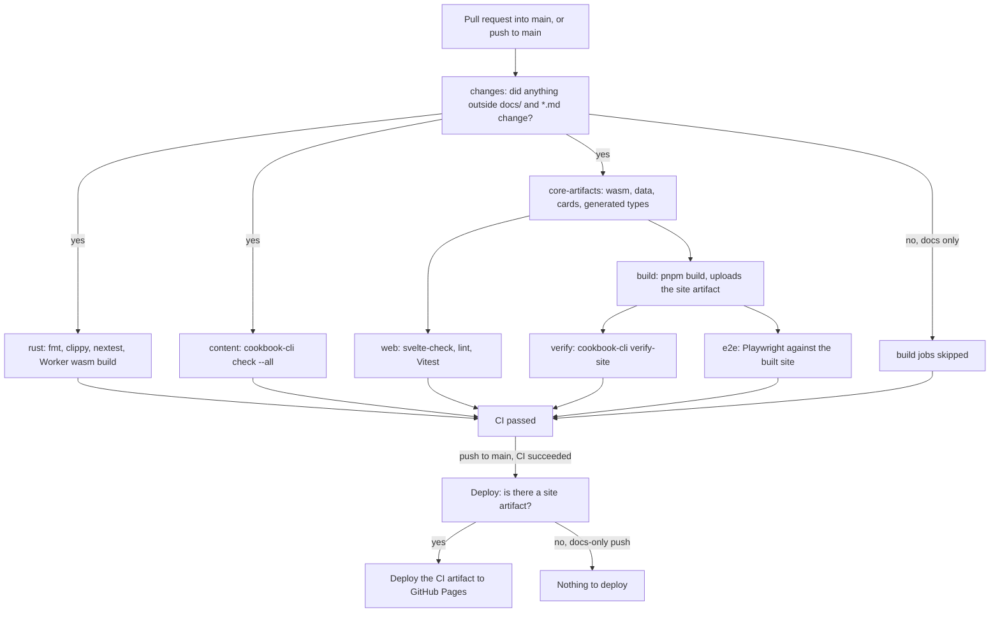
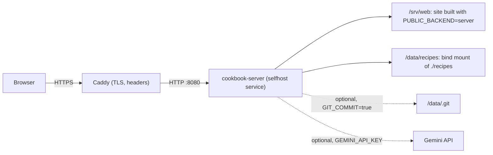

# Deployment

GitHub Pages is the main way to publish the cookbook. The AI features need a small Cloudflare Worker, deployed separately. Self-hosting is the alternative for running the cookbook without GitHub Pages: the same web app talks to an Axum server instead of reading static files.

## Contents

- [GitHub Pages](#github-pages)
- [The CI and deploy flow](#the-ci-and-deploy-flow)
- [Protecting main](#protecting-main)
- [The AI proxy (Cloudflare Worker)](#the-ai-proxy-cloudflare-worker)
- [Self-hosting](#self-hosting)

## GitHub Pages

The site is published from `main` only. Work happens on other branches and reaches `main` through pull requests.

1. In the repository's **Settings > Pages**, set **Source** to **GitHub Actions**.
2. Check `cookbook.config.json`: `site.url` and `site.basePath` must match the Pages address (`https://expo39.github.io` and `/My_Cookbook` for this repository). The CI build sets `BASE_PATH=/My_Cookbook` in `.github/workflows/ci.yml`; a fork under another name changes both. See [CONFIGURATION.md](CONFIGURATION.md).
3. Protect `main` as described in [Protecting main](#protecting-main).
4. Optionally, point the site at the AI Worker with `ai.endpoint` in `cookbook.config.json`.

There are no repository secrets to configure for Pages: the deploy uses the workflow's own token.

## The CI and deploy flow

CI (`.github/workflows/ci.yml`) runs on pull requests into `main` and on pushes to `main`. Deploy (`.github/workflows/deploy.yml`) runs only after CI completes successfully on a push to `main`, and publishes the very `site` artifact that CI built, tested and verified; it never rebuilds the site.



- **CI passed** is the single required check. It fails if any job failed or was cancelled, and treats skipped jobs as passed, so a docs-only pull request can still be merged.
- A change that touches only `docs/` or Markdown files skips every build job. On a push to `main`, CI then succeeds without producing a `site` artifact, and the deploy workflow's first job finds no artifact and skips the deploy. The live site is unchanged.
- CI runs cancel an older run on the same branch when a newer one starts. The in-site editor reports a cancelled run as replaced by a later build, not as a failure.
- Deploys never run concurrently and are not cancelled part-way.

## Protecting main

Nothing should reach `main` until everything passes.

- **On GitHub:** in **Settings > Rules > Rulesets**, add a branch ruleset targeting `main` with **Require a pull request before merging** and **Require status checks to pass**, adding the **CI passed** check. Turn on **Block force pushes**. A change then reaches `main` only through a pull request whose CI is green.
- **Locally:** run `make hooks` once per clone. It sets `core.hooksPath` to `.githooks`, whose `pre-push` hook runs `make test` before any push to `main` and refuses the push if anything fails. Pushes to other branches are not checked.

The in-site editor commits directly to the configured branch with the editor's token. If the ruleset blocks direct pushes to `main` for that account, either add the account to the ruleset's bypass list or point `admin.branch` at a branch that is merged by pull request.

## The AI proxy (Cloudflare Worker)

The static site cannot hold the Gemini key, so the sous-chef and the importer go through `crates/cookbook-worker`, a Rust Worker configured in `crates/cookbook-worker/wrangler.toml`. Everything runs in the dev container, so nothing is installed on the host.

1. Log in to Cloudflare and deploy the Worker. The first deploy creates the `RATE_LIMIT` KV namespace.

   ```sh
   docker compose run --rm dev npx wrangler login
   docker compose run --rm dev sh -c 'cd crates/cookbook-worker && npx wrangler deploy'
   ```

2. Add the secrets. `GEMINI_API_KEY` is a Google AI Studio key; `ADMIN_IMPORT_SECRET` keys the importer's admin proof (generate it with `openssl rand -hex 32`).

   ```sh
   docker compose run --rm dev sh -c 'cd crates/cookbook-worker && npx wrangler secret put GEMINI_API_KEY'
   docker compose run --rm dev sh -c 'cd crates/cookbook-worker && npx wrangler secret put ADMIN_IMPORT_SECRET'
   ```

3. Check the variables in `wrangler.toml`:
   - `SITE_URL` is the published site including its base path (`https://expo39.github.io/My_Cookbook`). The Worker fetches each recipe for `/chat` from `<SITE_URL>/data/recipes/<id>.json`, so it only ever discusses published recipes.
   - `ALLOWED_ORIGINS` lists the origins allowed to call it.
   - `GEMINI_MODEL`, `RATE_LIMIT_CHAT` and `RATE_LIMIT_IMPORT` tune the model and the hourly limits.
4. Set `ai.endpoint` in `cookbook.config.json` (or `PUBLIC_AI_ENDPOINT` at build time) to the Worker's URL, and enter the same `ADMIN_IMPORT_SECRET` in the site's editing settings (see [ADMIN.md](ADMIN.md#importing-a-recipe-with-ai)).

`make worker-build` builds the Worker without deploying it. No Cloudflare account id is committed; Wrangler takes it from `CLOUDFLARE_ACCOUNT_ID` or from the login. The routes, limits and the admin proof are documented in [crates/cookbook-worker/README.md](../crates/cookbook-worker/README.md).

## Self-hosting

### What it provides

`crates/cookbook-server` serves the built site and a JSON API with the same shapes as the static build (`cookbook_core::site`). It lets the editor save recipes, add sections and upload images behind a password, and it calls Gemini itself, so no Worker is needed. The site must be built with `PUBLIC_BACKEND=server` and `BASE_PATH=""`; `docker/server.Dockerfile` does both.



### Setting up

1. Copy `.env.example` to `.env`. It is git-ignored.
2. Create the password hash and paste it into `ADMIN_PASSWORD_HASH`, in single quotes so that Compose does not expand the `$` signs:
   ```sh
   printf '%s' 'the admin password' | docker compose run --rm -T dev cargo run -q -p cookbook-server -- --hash-password
   ```
3. Set `SESSION_SECRET` (for example from `openssl rand -hex 32`) and, if the AI features are wanted, `GEMINI_API_KEY`.
4. Start it with `make selfhost`, which runs `docker compose --profile selfhost up --build selfhost`. The site is then at `http://localhost:8080` (or the port in `SELFHOST_PORT`). Over plain HTTP set `COOKIE_SECURE=false`, otherwise the browser does not keep the session cookie.

`./recipes` is bind-mounted into the container, so edits land in the working copy. To commit each edit as well, set `GIT_COMMIT=true` and uncomment the `./.git` mount in `docker-compose.yml`; the repository's own git identity is used. The image has a health check (`cookbook-server --healthcheck`).

For development without the image, `make server` runs the server in the dev container on port 8080, serving `web/build`.

### Configuration

| Variable | Default | Meaning |
|---|---|---|
| `COOKBOOK_ROOT` | `.` (`/data` in the image) | the folder that contains `recipes/` |
| `WEB_DIR` | none (`/srv/web` in the image) | the built site; without it only the API is served |
| `ADMIN_PASSWORD_HASH` | required | argon2id hash from `--hash-password` |
| `SESSION_SECRET` | required | at least 32 characters; changing it signs everyone out |
| `GEMINI_API_KEY` | none | switches the AI endpoints on |
| `GEMINI_MODEL` | `gemini-3.8-flash` | any `generateContent` model id |
| `GEMINI_TEMPERATURE`, `GEMINI_MAX_OUTPUT_TOKENS` | `0.4`, `1024` | optional tuning |
| `BIND` | `0.0.0.0:8080` | listen address |
| `GIT_COMMIT` | `false` | commit each change with git |
| `COOKIE_SECURE` | `true` | the `Secure` flag on the session cookie |
| `TRUST_PROXY` | `false` | take the client address from the last `X-Forwarded-For` entry; only behind a proxy under the operator's control |
| `SELFHOST_PORT` | `8080` | the host port of the `selfhost` Compose service |

### HTTPS

Put Caddy in front. `docker/Caddyfile.example` is a complete configuration: replace the host name, run Caddy on the same Compose network so that it can reach `selfhost:8080`, and keep `COOKIE_SECURE=true` and `TRUST_PROXY=true`. Caddy obtains and renews the certificate itself, and the example adds HSTS, `X-Frame-Options` and `Referrer-Policy` headers.

### API

| method and path | session | purpose |
|---|---|---|
| `GET /api/index` | no | `SiteIndex` |
| `GET /api/recipes/{id}` | no | `RecipeData` |
| `GET /api/search?q=` | no | `SearchHit[]`; `?have=eggs,rice` gives `Coverage[]` |
| `GET /api/search-index` | no | the `SearchIndex` that `search.json` holds |
| `GET /api/images/{folder}/{file}` | no | an image from `recipes/` |
| `GET /api/session` | no | `{ authenticated }` |
| `POST /api/session` | no | `{ password }`; sets the cookie (5 failed attempts per 15 minutes per address) |
| `DELETE /api/session` | no | clears the cookie |
| `PUT /api/recipes/{id}` | yes | saves a `Recipe`; 422 with the checklist on errors |
| `DELETE /api/recipes/{id}` | yes | 409 with the linking recipes if any remain |
| `POST /api/sections` | yes | `{ path, title, order?, summary? }` |
| `POST /api/images/{id}` | yes | multipart, JPEG, PNG, WebP or GIF up to 8 MB; saved next to the recipe |
| `POST /api/ai/chat` | no | as the Worker's `/chat`; 30 per hour per address |
| `POST /api/ai/import` | yes | as the Worker's `/import`; 5 per hour per address |

Errors are `{ error, message }`; checklist failures add `results`.
