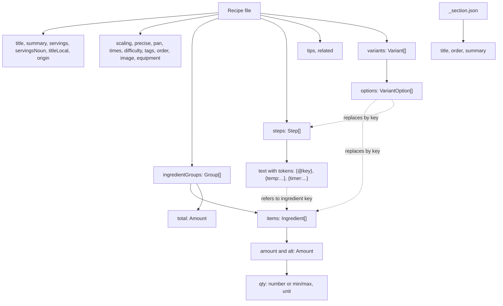

# Recipe format

This is the reference for the recipe files. Recipes live under `recipes/`, with one JSON file per recipe, and the folder tree defines the site's navigation:

```
recipes/
  first-courses/
    _section.json                 { "title": "First Courses", "order": 1 }
    pasta/
      _section.json               { "title": "Pasta", "order": 2 }
      one-pot-pasta.json
```

- The **recipe id is the file path without the extension**, relative to `recipes/` (e.g. `first-courses/pasta/one-pot-pasta`). Its last segment is the slug, made of lowercase letters, digits and hyphens.
- Every folder must contain an `_section.json` file. Sections can nest to any depth.
- Sections are sorted by `order` and then by title. Recipes within a section are sorted by `order` (optional) and then by title.

The Rust types in `crates/cookbook-core/src/schema.rs` are the source of truth. Unknown fields are rejected. `cookbook-cli schema` prints the JSON Schema (`cookbook-cli schema recipe` or `schema section` for one of them), and the web app's TypeScript types in `web/src/lib/types/recipe.ts` are generated from it with `make types`.

## Schema overview



## `_section.json`

| field | type | required | notes |
|---|---|---|---|
| `title` | string | yes | display name |
| `order` | integer | no | lower comes first |
| `summary` | string | no | one line shown on section pages |

## Recipe file

| field | type | required | notes |
|---|---|---|---|
| `title` | string | yes | |
| `summary` | string | yes | 1-2 sentences, shown on cards and as the intro |
| `servings` | integer >= 1 | yes | the servings the quantities are written for |
| `servingsNoun` | string \| `{ one, other }` | no | the plural alone (`"boards"`), or both forms (`{ "one": "person", "other": "people" }`); defaults to "serving" and "servings". `servings_label(n)` in the core, and `servingsLabel` in the web wrapper, give "1 person" or "4 people" |
| `titleLocal` | string | no | the Maltese or Italian name, shown under the title |
| `origin` | string | no | provenance, e.g. "Nanna Rita" or "adapted from ..." |
| `scaling` | `{ min?, max?, note? }` | no | the sensible range in servings; outside it the stepper warns but does not block |
| `precise` | bool | no | baking: finer gram rounding and fractional eggs shown by weight |
| `pan` | `{ shape: "round" \| "square" \| "rect", size: number[], depth? }` | no | cm; enables pan-size scaling by area ratio (with a warning if the depth differs) |
| `times` | `{ prep?, cook?, rest? }` | no | minutes |
| `difficulty` | `"easy" \| "medium" \| "hard"` | no | |
| `tags` | string[] | no | free-form groupings, e.g. `"Italian Classics"` |
| `order` | integer | no | position within its section |
| `image` | `{ src, alt }` | no | `src` is relative to the recipe file |
| `equipment` | string[] | no | |
| `ingredientGroups` | Group[] | yes, at least 1 | |
| `steps` | Step[] | yes, at least 1 | |
| `tips` | string[] | no | the "Chef's tip" |
| `variants` | Variant[] | no | |
| `related` | string[] | no | recipe ids |

### Group
`{ "name"?: string, "total"?: Amount, "items": Ingredient[] }`. `total` is a scalable headline amount, e.g. "Cheese (1150 g total)".

### Ingredient
| field | type | notes |
|---|---|---|
| `key` | string | optional; referenced from steps and variants |
| `food` | string | optional stable id, e.g. `flour-00` or `egg`; used for density lookup, merging shopping lists and ingredient search |
| `each` | number | grams per piece for discrete items (e.g. egg about 50) |
| `amount` | Amount | optional; omit it for "salt to taste" lines |
| `alt` | Amount | an author-given equivalent in a second unit, shown in brackets: "130 ml (9 tbsp)". It wins over the density table |
| `prefix` | string | text before the amount: "Zest of" 1 lemon |
| `item` | string | "short pasta" |
| `note` | string | "penne or rigatoni"; shown after a comma |
| `optional` | bool | |
| `scale` | `"linear" \| "discrete" \| "seasoning" \| "fixed" \| "toTaste"` | defaults to `linear`; `discrete` keeps whole pieces (eggs, cloves, tins); `seasoning` shows a range from 0.75x to 1x of the linear change, "start low"; `toTaste` marks salt and pepper with no amount, and the site shows "to taste" where the amount would be. Keep the words "to taste" out of `item`: the checklist warns (`W-TO-TASTE`) when they are there, or when salt or pepper has neither an amount nor `toTaste` |

### Amount
`{ "qty": number | { "min": number, "max": number }, "unit"?: Unit }`

Units: `g kg ml l tsp tbsp cup oz lb floz pinch`. With no unit the amount is a count, e.g. 2 eggs.

### Step
`{ "heading"?: string, "text": string, "key"?: string, "time"?: { "active"?: minutes, "passive"?: minutes } }`. `heading` starts a titled stage of the method (e.g. "Day 1: the night before"); following steps belong to it until the next heading. The per-step time drives the "serve at" planner. Inline tokens in `text`:

| token | renders as |
|---|---|
| `{@pasta}` | the scaled amount + item of the ingredient keyed `pasta`, e.g. "600 g short pasta" |
| `{@pasta:amount}` | the scaled amount only, e.g. "600 g" |
| `{@sugar*1/2}` | a fraction of the ingredient, for one split across several steps |
| `{temp:200}` | "200 °C", converted with the unit setting (°F, gas mark) |
| `{temp:200/180}` | "200 °C (180 °C fan)" |
| `{temp:180-200}` | an oven range, "180-200 °C" (350-400 °F); a range takes no fan value |
| `{temp:63!}` / `{temp:52-55!}` | a trailing `!` marks an internal or meat temperature: "63 °C", "52-55 °C". It converts to the nearest °F ("126-131 °F"), not to oven steps of 25, shows no gas mark, and takes no fan value |
| `{timer:12}` / `{timer:12-15}` / `{timer:12\|pasta}` | "12-15 min", which starts a timer (optionally named) when tapped |
| `{timer:0.5}` / `{timer:30s}` | "30 sec"; any duration under a minute reads in seconds |
| `{timer:90}` / `{timer:4h}` / `{timer:3-4h}` | "1 h 30 min", "4 h", "3-4 h"; 60 minutes or more reads in hours |

Displayed ranges use an en dash in the site. Timer values are minutes unless they end in `s`, `m` or `h`. In a range, a unit on the last value applies to the first too (`3-4h`, `30-90s`), and either value may carry its own (`45m-1.5h`). Ranges read in hours when both ends are whole multiples of 30 minutes (`1.5-2 h`); otherwise each end is written out (`45 min-1 h 30 min`).

### Variant
```json
{ "key": "vanilla", "label": "Vanilla",
  "options": [
    { "key": "extract", "label": "Extract", "default": true },
    { "key": "pods", "label": "Pods",
      "ingredients": { "vanilla": { "amount": { "qty": 1 }, "item": "vanilla pod, split and scraped" } },
      "steps": { "infuse": "Split the pod lengthwise..." },
      "tips": ["Vanilla pods give the most authentic flavour..."] } ] }
```
Each option replaces the ingredients and steps by key. If `tips` is given, it replaces the recipe's tips.

## Scaling rules
Times, temperatures and cookware are never scaled automatically. When the scale changes, the method shows "check from the original time" beside timed steps, and from 2x upwards a "cook in batches" hint appears. The rounding tables per unit are in `docs/research/FEATURES.md`.

## Details the checklist and scaling engine rely on
- A recipe has to sit inside a section folder; a file directly under `recipes/` has no section and fails `E-SECTION-MISSING`.
- `pan.size` is `[diameter]` for round, `[width, length]` for rect, and `[side]` or `[width, length]` for square. `loaf` is not a shape yet.
- `scaling.min` and `scaling.max` are servings. `image.alt` may be omitted in the file, but then `E-IMAGE-ALT` fails.
- `image.src` must be a JPEG, PNG or WebP file (`E-IMAGE-FORMAT`), and a photo narrower than 1200 px gets `W-IMAGE-SMALL`. `cookbook-cli build` writes it at 480, 960 and 1600 px (never above its own width) as WebP and JPEG to `web/static/img/<id>/<width>.<ext>`, and records its size so the page can reserve the space. `cookbook-cli cards` draws the recipe's share cards to `web/static/cards/<id>/` (`og.png`, `portrait.png` and `story.png`), with the photo at the top when there is one.
- A variant option replaces a whole ingredient (its `key` is taken from the map key) and may only name keys that exist in the recipe.
- `seasoning` above 1x shows `max(base, 0.75 * base * f)` to `base * f`; at or below 1x it is plain linear.
- `discrete` rounds to the nearest whole piece (minimum 1). Only when the recipe is `precise` and the ingredient has `each` does a fractional part of 0.25 to 0.75 show as a half with its weight, e.g. "1½ (75 g) eggs".
- A cup is 240 ml, a tablespoon 15 ml, a teaspoon 5 ml and a US fluid ounce 30 ml. An ingredient with an `alt` is shown in its authored units and never converted.
- Token modifiers combine as `{@key:amount*1/2}`. `{timer:12-15|name}` takes both a range and a name.

## Validation
`cookbook-cli check` runs the recipe checklist; `make check` runs it over the whole tree. Errors have ids starting `E-` and stop the build; warnings start `W-` and are reported but allowed. The same rules run in the in-site editor (through WASM), in CI and on the self-hosted server. See [ARCHITECTURE.md](ARCHITECTURE.md#where-the-checklist-runs).
